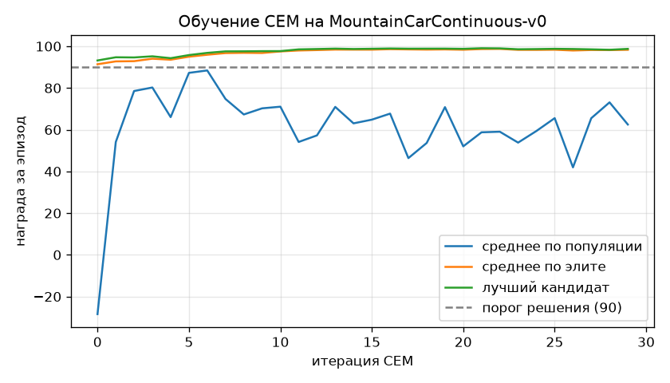
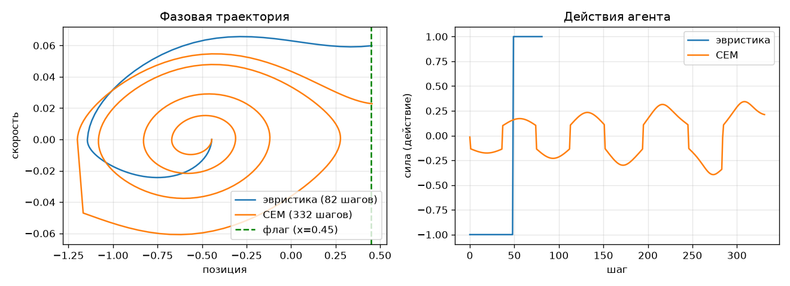

# MountainCarContinuous-v0 — решение

Решение задачи [Mountain Car Continuous](https://gymnasium.farama.org/environments/classic_control/mountain_car_continuous/)
из набора [Classic Control](https://gymnasium.farama.org/environments/classic_control/) библиотеки Gymnasium.

## Итоговый результат

Оценка на 100 эпизодах (сиды 10000–10099, которые не использовались при обучении (что в целом логично и соответствует правилам)).
Среда считается решённой, если средняя награда **≥ 90**.

| Политика | Средняя награда | Шагов до флага | Успешных эпизодов | Итог |
|---|---|---|---|---|
| Эвристика «толкать по скорости» | 92.05 ± 0.20 | 79.5 | 100 % | решено |
| **Обученная политика (CEM)** | **98.57 ± 0.21** | 317.9 | 100 % | **решено** |

## Как запустить (VS Code)

```bash
python -m venv .venv
```

```bash
.venv\Scripts\pip install -r requirements.txt
```

```bash
.venv\Scripts\python mountain_car_continuous.py train
```

Другие команды: `evaluate` — только оценка, `render` — показать агента в окне.
В VS Code те же три команды есть во вкладке **Run and Debug** (файл `.vscode/launch.json`).

Обучение занимает около минуты на обычном ноутбуке, GPU не нужен.

---

## 1. Постановка задачи

Машина стоит в яме между двумя холмами. Цель — заехать на правый холм до флага (позиция `x ≥ 0.45`).

| | Описание |
|---|---|
| Наблюдение | `[x, v]`: позиция `x ∈ [-1.2, 0.6]`, скорость `v ∈ [-0.07, 0.07]` |
| Действие | одно число — сила `a ∈ [-1, 1]` (влево/вправо) |
| Физика | `v ← v + 0.0015·a − 0.0025·cos(3x)`, затем `x ← x + v` |
| Награда | `−0.1·a²` за каждый шаг + `100` за достижение флага |
| Старт | `x ∈ [-0.6, -0.4]` случайно, `v = 0` |
| Конец | флаг достигнут, либо прошло 999 шагов |

### В чём сложность

1. **Двигатель слабый.** Максимальная сила (`0.0015`) меньше, чем составляющая гравитации на склоне
   (до `0.0025`). Если просто жать «вправо», машина застрянет на середине склона. Нужно
   **раскачаться**: отъехать назад на левый холм и использовать накопленную энергию.
2. **Ловушка «ничего не делать».** Каждое действие стоит `−0.1·a²`. Пока агент ни разу не доехал
   до флага, он видит только штрафы, и лучшая политика с его точки зрения — стоять на месте
   (награда ≈ 0). Поэтому стандартные RL-алгоритмы (DDPG, SAC) часто застревают здесь без
   дополнительного исследования.
3. **Компромисс энергия/время.** Чем слабее давить, тем меньше штраф, но тем дольше раскачка.
   Если давить слишком слабо — машина не успеет за 999 шагов и получит отрицательную награду.

## 2. Подход 1 — физическая эвристика

Идея из механики: работа силы `a` за шаг пропорциональна `a·v`. Чтобы энергия машины
**росла максимально быстро**, сила должна совпадать по направлению со скоростью:

```
a = +1, если v > 0
a = −1, если v < 0   (и на старте, когда v = 0)
```

Это то же, что раскачивать качели: толкать в ту сторону, куда они уже летят.

Результат: машина доезжает до флага за ~80 шагов, награда ≈ `100 − 0.1·1²·80 ≈ 92`.
Задача формально решена (≥ 90), но давить всё время на полную мощность — расточительно.

## 3. Подход 2 — обучение методом кросс-энтропии (CEM)

### Политика

Параметрическая политика с 4 весами `θ`:

```
a = tanh(θ₁·x̂ + θ₂·v̂ + θ₃·sign(v) + θ₄)
```

где `x̂ = (x + 0.3)/0.9`, `v̂ = v/0.07` — нормированные наблюдения (чтобы веса были одного масштаба),
`tanh` гарантирует, что действие в допустимом диапазоне `[-1, 1]`.

### Алгоритм CEM

Cross-Entropy Method — эволюционный метод без градиентов. Вместо одной политики храним
**распределение** над весами `θ ~ N(μ, σ²)`:

1. Сэмплируем популяцию из 40 наборов весов.
2. Каждый набор играет 10 эпизодов (одни и те же сиды для всех — честное сравнение).
3. Отбираем 20 % лучших — «элиту».
4. Новые `μ` и `σ` = среднее и стандартное отклонение элиты (+0.05 к σ, чтобы не схлопнуться раньше времени).
5. Повторяем 30 итераций.

### Почему CEM, а не DDPG/SAC

* **Решает ловушку исследования.** Стартовая σ = 2 очень широкая: уже на 0-й итерации
  среди 40 случайных политик есть те, что раскачивают машину и доезжают до флага (лучшая — 93).
  CEM сравнивает целые эпизоды, поэтому сразу «видит» бонус +100 и тянет распределение к нему.
  Градиентным методам с шумом в действиях нужно случайно доехать до флага, что маловероятно.
* **Мало параметров.** Задача по сути одномерная; 4 веса хватает, нейросеть не нужна.
* **Только numpy**, обучение около минуты.

### Как улучшалось решение (важная часть)

**Попытка 1: политика `tanh(θ·[x̂, v̂, 1])`, 5 эпизодов на кандидата.**
Результат на тесте: 97.90 ± 9.84, но **1 эпизод из 100 провален**.

CEM, стремясь уменьшить штраф за энергию, нашёл слишком слабую силу. Причина провалов:
при `a ∝ v` в начале эпизода `v = 0` → сила почти нулевая. Если машина стартует близко к дну ямы,
ей нечем раскачиваться, и за 999 шагов она не доезжает.

**Попытка 2: робастная оценка.** Оценка кандидата = `mean − 0.5·(mean − min)` по 10 эпизодам,
чтобы штрафовать за худший эпизод. Стало хуже — 3 провала из 100: на 10 эпизодах редкая
неудача просто не попадается, а главная проблема (нулевая сила при малой скорости) осталась.

**Попытка 3 (финал): добавлен признак `sign(v)`.**
Он даёт **постоянную добавку силы** по направлению движения, даже когда скорость маленькая.
Мёртвая точка исчезла, и CEM смог сделать силу маленькой без риска застрять.
Результат: **98.57 ± 0.21, 100 % успехов.**

### Что выучила политика

```
θ = [0.005, 0.326, 0.117, −0.014]
a ≈ tanh(0.33·v̂ + 0.12·sign(v))
```

* `θ₁ ≈ 0`, `θ₄ ≈ 0` — позиция и смещение не важны.
* Остальное — **та же идея, что в эвристике** («толкай по скорости»), но мягко:
  сила около 0.1–0.4 вместо 1. CEM сам «переоткрыл» физический принцип раскачки
  и подобрал оптимальную мощность.

Почему это выгоднее: машина раскачивается ~320 шагов вместо 80, но штраф `0.1·a²`
при `a ≈ 0.2` в 25 раз меньше, чем при `a = 1`. Итоговый штраф ~1.4 вместо ~8.

## 4. Графики

`results/training_curve.png` — ход обучения.



* Зелёная и оранжевая линии (лучший кандидат и элита) уже на 0-й итерации выше 90
  и к 10-й итерации выходят на ~98.5.
* Синяя линия (среднее по всей популяции) колеблется около 50–70 — это нормально.
  Оптимум лежит у границы «доезжает / не доезжает»: часть случайных кандидатов вокруг μ
  давят чуть слабее, чем нужно, и проваливаются. На итоговую политику (μ) это не влияет.

`results/trajectory.png` — один эпизод (сид 42) для обеих политик.



* **Слева** — фазовый портрет (позиция–скорость). Эвристика делает один большой виток:
  откат влево до стенки (`x = −1.2`) и разгон до флага. CEM раскручивает спираль из нескольких
  витков с нарастающей амплитудой — классическая раскачка.
* **Справа** — действия. Эвристика: `−1` затем `+1` (bang-bang). CEM: плавная синусоида
  малой амплитуды, знак которой совпадает со знаком скорости.

## 5. Структура проекта

```
mountain_car_continuous.py   — весь код: политики, CEM, оценка, графики
requirements.txt             — зависимости
results/cem_policy.json      — обученные веса θ и история обучения
results/training_curve.png   — график обучения
results/trajectory.png       — фазовые траектории и действия
.vscode/launch.json          — конфигурации запуска для VS Code
```
